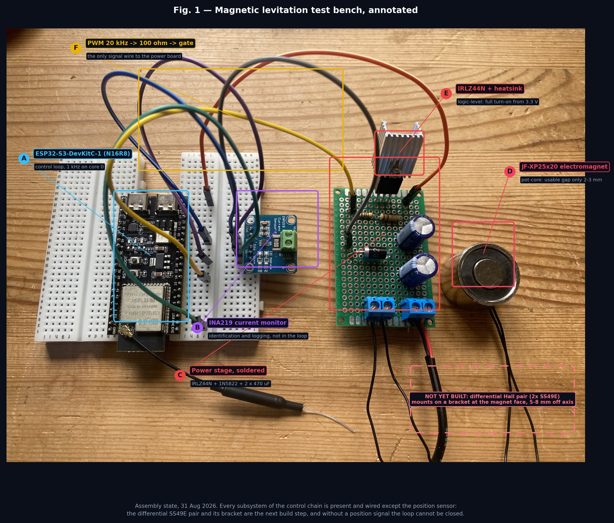
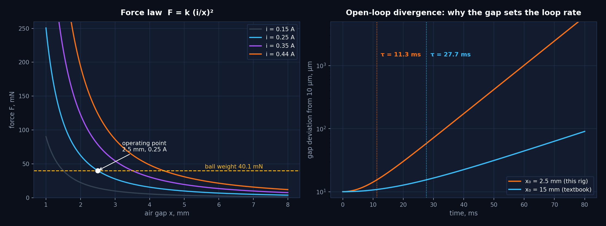
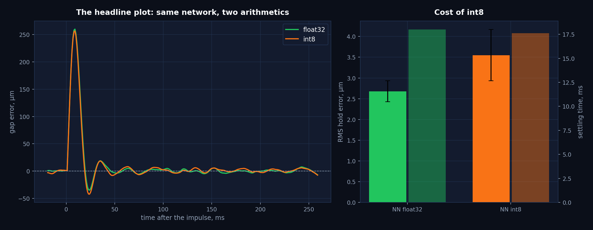
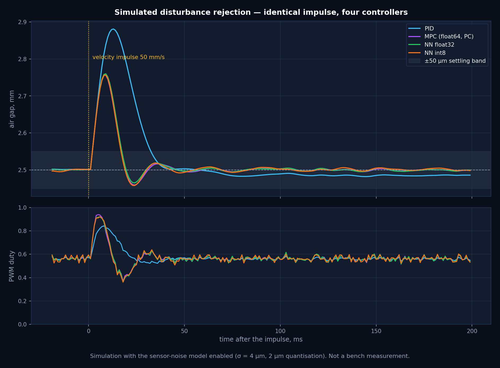
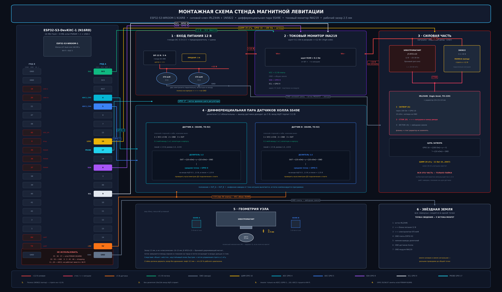

# Closed-loop cost of int8 quantisation on an unstable plant

**A magnetic levitation testbed for measuring how much control quality a
neural controller loses when its arithmetic drops from float32 to int8.**

Svyatoslav Nikulin · Ural Federal University, Control Engineering (27.03.04)
· [Русская версия](README.ru.md)



---

## Project status — read this first

| Phase | State |
|---|---|
| 1. Actuator characterisation and design | **complete** — see [findings](#result-1-the-actuator-decides-the-control-problem) |
| 2. Hardware build | **complete except the position sensor** — power stage soldered and wired, see Fig. 1 |
| 3. Position sensing and calibration | **in progress** |
| 4. Closed-loop levitation and measurement | **in progress** |

The measurement protocol in [`docs/03`](docs/03-measurement-protocol.md) was
written and the predictions recorded *before* the corresponding experiments,
so that a future disagreement between model and bench stays visible instead of
being absorbed into a re-tuned parameter.

The two results that already exist — the actuator field analysis and the
simulated quantisation cost — are stated below.

---

## 1. The question

A model predictive controller produces a good policy for this plant and does
not fit on the microcontroller: it solves a 40-step quadratic program, roughly
40 ms per step on a PC against the 1 ms the loop allows. The standard remedy is
to train a small network to imitate the MPC policy and quantise it to int8.

The open-loop approximation error of such a network is routinely reported.
The quantity that actually matters is different:

> **How much closed-loop control quality is lost when the arithmetic drops
> from float32 to int8, on a plant that amplifies every error exponentially?**

An unstable plant is the honest test case. On a stable plant a small policy
error decays; here it grows with a time constant of 11.3 ms, so the loop
either holds the ball or it does not — there is no partially working demo.

## 2. The plant

A steel sphere is held below an electromagnet by feedback alone.

$$F(i, x) \approx k \left(\frac{i}{x}\right)^2, \qquad
k = 4.01\ \mu\text{N}\cdot\text{m}^2/\text{A}^2$$

Linearised about the operating point $(i_0, x_0)$, the equilibrium condition
$F = mg$ gives

$$\frac{\partial F}{\partial x}\bigg|_{x_0} = -\frac{2mg}{x_0}, \qquad
\frac{\partial F}{\partial i}\bigg|_{i_0} = \frac{2mg}{i_0}, \qquad
s_{\text{pole}} = \sqrt{\frac{2g}{x_0}}$$

The pole sits in the right half-plane and depends only on the gap — not on the
magnet, not on the mass. That single fact drives the entire design.

| Quantity | Value | Source |
|---|---|---|
| Ball mass | 4.09 g | computed, Ø10 mm SHKh15, ρ = 7810 kg/m³ |
| Operating gap $x_0$ | 2.5 mm | design decision, see §3 |
| Bias current $i_0$ | 0.25 A | design decision, ≈55 % of $i_{max}$ |
| Unstable pole | 88.6 rad/s | computed |
| Divergence time constant | **11.3 ms** | computed |
| Coil electrical constant $L/R$ | 1.48 ms | computed from assumed L, R |
| Control loop rate | 1 kHz | design decision — 11.3 samples per τ |

Reproduce: `python3 analysis/plant_model.py`



## 3. Result 1 — the actuator decides the control problem

The literature places the levitation gap at 10–15 mm. On this hardware a
Ø10 mm sphere is attracted only from **1–2 mm**. The cause is the actuator's
magnetic topology, and it is not a defect.

The JF-XP25×20 is a **pot-core holding electromagnet**: the central core is one
pole, the outer steel cup is the other, and the annular gap between them at the
face is 1.5–2 mm. Flux follows the path of least reluctance
$R_m = l / (\mu_0 \mu_r S)$; beyond a 2 mm air gap the external path to the
ball becomes tens of times worse than the core-to-cup path across the face, so
the flux shunts at the face and never reaches the ball. The nameplate 50 N is
measured at **zero gap against a flat soft-steel plate** that closes the
magnetic circuit — a sphere touches at one point, closes nothing, and drives
the contact region into saturation ($B_{sat} \approx 1.8$–2.0 T).

**Consequence.** The operating point moves to $x_0 = 2.5$ mm, and the plant
becomes 2.45× faster than the textbook case:

| Gap | Pole | Divergence τ |
|---|---|---|
| 2.5 mm (this rig) | 88.6 rad/s | 11.3 ms |
| 15 mm (textbook) | 36.2 rad/s | 27.7 ms |

This is why the loop runs at 1 kHz on a dedicated core, why the derivative
filter is limited to τ = 2 ms, and why mechanical backlash in the stand is a
first-order concern rather than a detail: 0.5 mm of play is 20 % of the working
range.

Full analysis: [`docs/01-actuator-analysis.md`](docs/01-actuator-analysis.md)

## 4. Result 2 — simulated cost of int8

Four controllers, identical plant, identical disturbance (50 mm/s velocity
impulse), identical sensor-noise model (σ = 4 µm, 2 µm quantisation), eight
noise realisations each. **No controller sees the true state**: position comes
through the noise model and coil current through the same first-order observer
the firmware uses, because the INA219 is too slow to sit inside a 1 ms loop.

| Controller | RMS hold error | Settling time | Capture range | Footprint |
|---|---|---|---|---|
| PID | 2.36 ± 0.34 µm | 33.1 ± 0.3 ms | 1.78 mm | — |
| MPC (float64, PC) | 2.61 ± 0.24 µm | 17.8 ± 0.4 ms | 1.78 mm | does not fit |
| Neural net, float32 | 2.68 ± 0.25 µm | 18.0 ± 0.0 ms | 1.77 mm | 1412 B |
| **Neural net, int8** | **3.55 ± 0.62 µm** | **17.6 ± 0.5 ms** | **1.32 mm** | **452 B** |

*Simulation, not bench measurement. Reproduce: `python3 analysis/simulate_controllers.py`*



Three findings, and the third is the interesting one:

1. **The network reproduces the MPC.** float32 matches the MPC to within
   0.07 µm RMS and to the resolution of the settling measurement, at a small
   fraction of the computational cost: 320 multiply-accumulates against a
   40-step quadratic program. Imitation works.
2. **int8 costs some precision and no speed.** Hold error grows 1.33×
   (2.68 → 3.55 µm) while settling time does not degrade at all
   (18.0 → 17.6 ms). Open-loop imitation error, meanwhile, rises 3.1×
   (0.0022 → 0.0069 duty units) — so the closed loop absorbs most of the
   arithmetic error rather than amplifying it, at least while the ball is
   near the setpoint.
3. **int8 shrinks the region of attraction by 25 %** (1.77 → 1.32 mm), and
   this is the finding that does not follow from the open-loop error at all.
   Near the setpoint the loop is forgiving; at the edge of the trained region
   the quantised policy extrapolates worst and the plant is least forgiving,
   and the two coincide. **A quantisation report that measures only tracking
   accuracy would miss this entirely** — and on an unstable plant, losing a
   quarter of the capture range matters more than a micrometre of jitter.

The bench experiment exists to test whether finding 3 survives contact with
real sensor noise, coil heating and a non-ideal force law.



## 5. System



| Subsystem | Implementation | Why |
|---|---|---|
| Controller | ESP32-S3-WROOM-1 N16R8, 240 MHz dual core | control loop pinned to core 0, Wi-Fi telemetry on core 1 — Wi-Fi cannot steal the tick |
| Actuator | JF-XP25×20, 12 V, ~27 Ω | see §3 |
| Switch | IRLZ44N + 1N5822 + heatsink | logic-level gate: full turn-on from 3.3 V |
| Position | 2 × SS49E, differential | coil field is common-mode and subtracts; ball position does not |
| Level shift | 10k/10k dividers | SS49E swings to 5 V, the ADC tolerates 3.3 V |
| Current | INA219, I²C | identification and logging only — 0.5 ms per read is half the control period |

Pin assignment is not the classic ESP32 one and cannot be: on the S3 the
familiar GPIO 34/35 do not exist, **GPIO 35/36/37 are consumed by the octal
PSRAM of the N16R8**, and ADC2 stops working when Wi-Fi is enabled — so the
analogue inputs must live on ADC1 (GPIO 1–10).

| Signal | Pin | Note |
|---|---|---|
| Hall A / Hall B | GPIO 4 / GPIO 5 | ADC1_CH3 / ADC1_CH4 |
| PWM to gate | GPIO 16 | LEDC, 20 kHz, 11 bit |
| I²C SDA / SCL | GPIO 8 / GPIO 9 | INA219 |
| Step-time probe | GPIO 17 | scope, measures the control step directly |

Wiring, board layout and build log: [`docs/02`](docs/02-system-design.md),
[`docs/04`](docs/04-build-log.md).

## 6. Repository

```
docs/     01 actuator analysis · 02 system design · 03 measurement protocol
          04 build log · 05 limitations · 06 FAQ           (EN and RU)
hardware/ schematic, board layout, interconnect map, BOM, figure generators
firmware/ 01 PWM bring-up · 02 Hall readout · 03 INA219 · 04 PID + web UI
          05 int8 neural controller (hand-written inference, no framework)
analysis/ plant model · MPC + training + quantisation pipeline · figures
data/     calibration and result templates, simulation output
```

Reproduce everything:

```bash
pip install -r analysis/requirements.txt
python3 analysis/plant_model.py            # parameter table
python3 analysis/simulate_controllers.py   # ~90 s, writes data/results/
python3 analysis/export_weights.py         # regenerates the firmware headers
python3 analysis/make_figures.py           # regenerates the figures
```

## 7. Limitations

Stated in full in [`docs/05-limitations.md`](docs/05-limitations.md), with the
questions a reviewer is likely to raise answered in
[`docs/06-faq.md`](docs/06-faq.md). The short version:

- **No closed-loop bench data exists yet.** Every controller number above is
  simulated.
- $R_{coil}$ and $L_{coil}$ are datasheet-class assumptions, not measurements;
  the electrical time constant, and with it the current observer, depends on
  them.
- The sensor noise model (σ = 4 µm) is an assumption. If the real differential
  pair is noisier, every RMS figure moves and the PID gains change with it.
- Common-mode rejection of the Hall pair will be imperfect; the residual
  current-to-position leakage is compensated in software, which is a
  correction, not a cure.
- Coil heating shifts $R$ and therefore the operating point. It is measured
  in protocol P1 and not modelled.
- The pot-core topology restricts the working gap to 2–3 mm; results do not
  transfer directly to open-solenoid rigs.

## 8. Where this goes next

Three directions this bench opens, in increasing order of ambition:

1. **Quantisation-aware control design.** The result here says the cost of
   int8 concentrates at the edge of the region of attraction, not around the
   setpoint. If that survives the bench, it argues for training the imitation
   network with a loss weighted toward the boundary, or for certifying the
   region of attraction of the *quantised* policy rather than the float one.
2. **Comparison against embedded convex solvers.** TinyMPC and similar ADMM
   solvers now run on microcontrollers. The trade is determinism against
   optimality: a fixed-cost network versus a solver with a variable iteration
   count and a hard 1 ms deadline. This bench can measure both on the same
   plant.
3. **More degrees of freedom.** The vertical axis is actively controlled and
   the radial axes rely on the pole geometry — Earnshaw's theorem guarantees
   that a passive arrangement cannot be stable in all three
   ([FAQ](docs/06-faq.md)). A multi-coil suspension makes the radial problem
   explicit and turns the same quantisation question into a MIMO one, which
   is where magnetic bearings live.

Questions I would want to work on in a host laboratory: how the region of
attraction of a learned controller can be certified rather than measured, and
whether the boundary-concentrated degradation seen here generalises to other
unstable plants and other quantisation schemes.

## 9. Citation

See [`CITATION.cff`](CITATION.cff). Licensed MIT.
