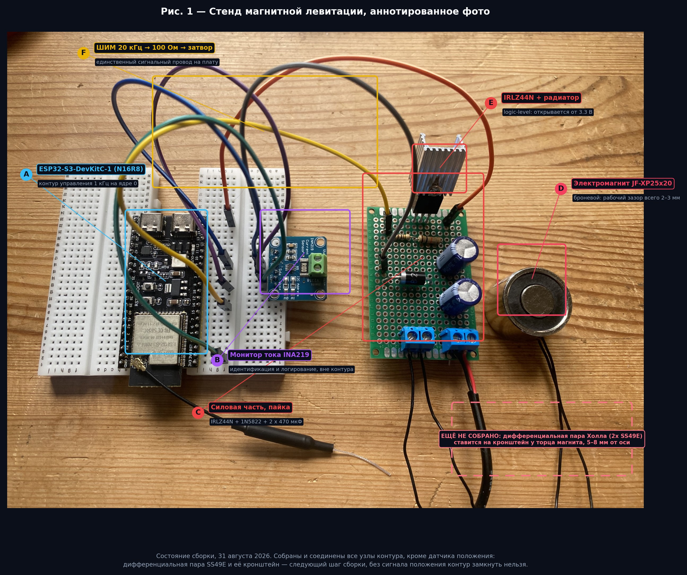
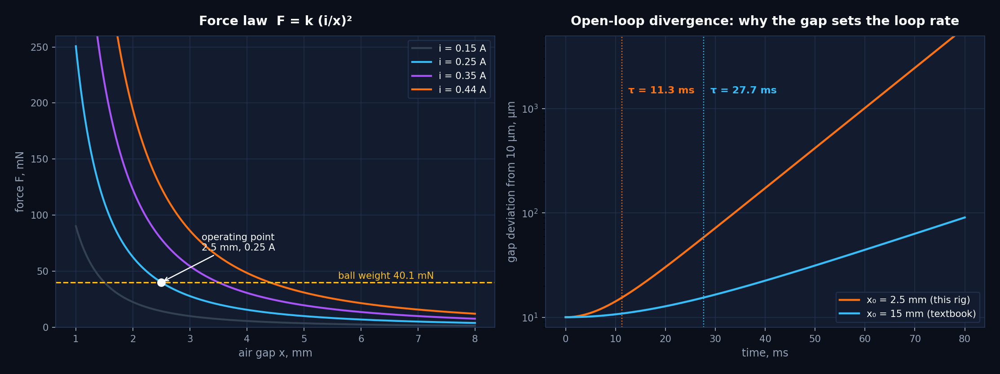
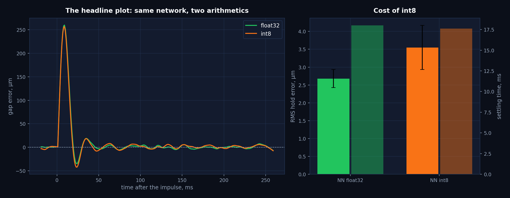
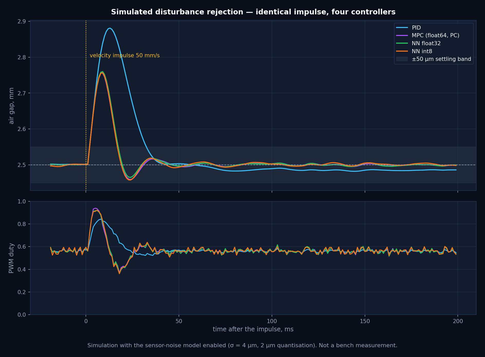
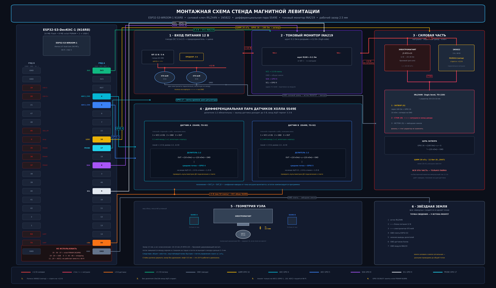

# Цена квантования int8 в замкнутом контуре на неустойчивом объекте

**Стенд магнитной левитации для измерения того, сколько качества управления
теряет нейроконтроллер при переходе с float32 на int8.**

Святослав Никулин · Уральский федеральный университет, «Управление в
технических системах» (27.03.04) · [English version](README.md)



---

## Статус проекта — прочитать первым

| Фаза | Состояние |
|---|---|
| 1. Исследование актуатора и проектирование | **завершена** — см. [результат](#результат-1--актуатор-определяет-задачу-управления) |
| 2. Сборка железа | **завершена, кроме датчика положения** — силовая часть спаяна и подключена, рис. 1 |
| 3. Измерение положения и калибровка | **в работе** |
| 4. Замкнутый контур и измерения | **в работе** |

Протокол измерений в [`docs/03`](docs/03-measurement-protocol.ru.md) написан, а предсказания
зафиксированы **до** соответствующих экспериментов — чтобы будущее расхождение
модели и стенда осталось видимым, а не растворилось в подстроенном параметре.

Два результата, которые уже получены — анализ поля актуатора и симуляционная
цена квантования — изложены ниже.

---

## 1. Вопрос

Регулятор MPC даёт для этого объекта хорошую политику и не помещается в
микроконтроллер: он решает квадратичную задачу на горизонте 40 шагов, около
40 мс на шаг на ПК против 1 мс, которые отводит контур. Стандартное решение —
обучить маленькую сеть имитировать политику MPC и квантовать её в int8.

Ошибку аппроксимации такой сети в разомкнутом контуре измеряют все. Важна
другая величина:

> **Сколько качества управления теряется в замкнутом контуре при переходе
> с float32 на int8 — на объекте, который экспоненциально усиливает любую
> ошибку?**

Неустойчивый объект — честный тестовый случай. На устойчивом объекте малая
ошибка политики затухает; здесь она нарастает с постоянной времени 11.3 мс,
поэтому контур либо удерживает шарик, либо нет — «почти работающей»
демонстрации не бывает.

## 2. Объект

Стальной шарик удерживается под электромагнитом одной лишь обратной связью.

$$F(i, x) \approx k \left(\frac{i}{x}\right)^2, \qquad
k = 4{,}01\ \mu\text{Н}\cdot\text{м}^2/\text{А}^2$$

После линеаризации вокруг рабочей точки $(i_0, x_0)$ условие равновесия
$F = mg$ даёт

$$\frac{\partial F}{\partial x}\bigg|_{x_0} = -\frac{2mg}{x_0}, \qquad
\frac{\partial F}{\partial i}\bigg|_{i_0} = \frac{2mg}{i_0}, \qquad
s_{\text{полюс}} = \sqrt{\frac{2g}{x_0}}$$

Полюс лежит в правой полуплоскости и зависит **только от зазора** — не от
магнита и не от массы. Этот единственный факт определяет всю конструкцию.

| Величина | Значение | Источник |
|---|---|---|
| Масса шарика | 4,09 г | расчёт, Ø10 мм ШХ15, ρ = 7810 кг/м³ |
| Рабочий зазор $x_0$ | 2,5 мм | проектное решение, §3 |
| Ток смещения $i_0$ | 0,25 А | проектное решение, ≈55 % от $i_{max}$ |
| Неустойчивый полюс | 88,6 рад/с | расчёт |
| Постоянная расхождения | **11,3 мс** | расчёт |
| Электрическая постоянная $L/R$ | 1,48 мс | расчёт по принятым L, R |
| Частота контура | 1 кГц | проектное решение — 11,3 отсчёта на τ |

Воспроизвести: `python3 analysis/plant_model.py`



## 3. Результат 1 — актуатор определяет задачу управления

Литература помещает зазор левитации на 10–15 мм. На этом железе шарик Ø10 мм
притягивается только с **1–2 мм**. Причина — магнитная топология актуатора,
и это не дефект.

JF-XP25×20 — **броневой удерживающий электромагнит (pot-core)**: центральный
керн является одним полюсом, внешний стальной стакан — другим, а кольцевой
зазор между ними на торце составляет 1,5–2 мм. Поток идёт по пути наименьшего
магнитного сопротивления $R_m = l / (\mu_0 \mu_r S)$; при воздушном зазоре
больше 2 мм внешний путь до шарика становится в десятки раз хуже пути
«керн — стакан» прямо на торце, поэтому поток шунтируется на торце и до шарика
не доходит. Паспортные 50 Н измеряются **при нулевом зазоре на плоской плите
из мягкой стали**, замыкающей магнитную цепь: шарик касается в одной точке,
ничего не замыкает и вводит область контакта в насыщение
($B_{sat} \approx 1{,}8$–2,0 Тл).

**Следствие.** Рабочая точка переносится на $x_0 = 2{,}5$ мм, и объект
становится в 2,45 раза быстрее «учебникового»:

| Зазор | Полюс | Постоянная расхождения τ |
|---|---|---|
| 2,5 мм (этот стенд) | 88,6 рад/с | 11,3 мс |
| 15 мм (учебник) | 36,2 рад/с | 27,7 мс |

Именно поэтому контур работает на 1 кГц на выделенном ядре, фильтр производной
ограничен τ = 2 мс, а механический люфт стойки — вопрос первого порядка,
а не деталь: 0,5 мм люфта составляют 20 % рабочего диапазона.

Полный разбор: [`docs/01`](docs/01-actuator-analysis.ru.md)

## 4. Результат 2 — симуляционная цена int8

Четыре регулятора, один объект, одно возмущение (импульс скорости 50 мм/с),
одна модель шума датчика (σ = 4 мкм, квантование 2 мкм), по восемь реализаций
шума на каждый. **Ни один регулятор не видит истинного состояния**: положение
приходит через модель шума, а ток катушки — через тот же наблюдатель первого
порядка, что и в прошивке, поскольку INA219 слишком медленный для такта 1 мс.

| Регулятор | СКО удержания | Время успокоения | Диапазон захвата | Память |
|---|---|---|---|---|
| ПИД | 2,36 ± 0,34 мкм | 33,1 ± 0,3 мс | 1,78 мм | — |
| MPC (float64, ПК) | 2,61 ± 0,24 мкм | 17,8 ± 0,4 мс | 1,78 мм | не помещается |
| Нейросеть, float32 | 2,68 ± 0,25 мкм | 18,0 ± 0,0 мс | 1,77 мм | 1412 Б |
| **Нейросеть, int8** | **3,55 ± 0,62 мкм** | **17,6 ± 0,5 мс** | **1,32 мм** | **452 Б** |

*Симуляция, не измерение на стенде. Воспроизвести: `python3 analysis/simulate_controllers.py`*



Три вывода, и третий — самый интересный:

1. **Сеть воспроизводит MPC.** float32 совпадает с MPC с точностью 0,07 мкм по
   СКО и до разрешения измерения времени успокоения — при несопоставимо меньшей
   вычислительной стоимости (320 MAC против задачи QP на 40 шагов). Имитация работает.
2. **int8 стоит части точности и не стоит быстродействия.** Ошибка удержания
   растёт в 1,33 раза (2,68 → 3,55 мкм), тогда как время успокоения не
   деградирует вовсе (18,0 → 17,6 мс). При этом ошибка имитации в разомкнутом
   контуре выросла в 3,1 раза (0,0022 → 0,0069 в единицах заполнения) — то есть
   замкнутый контур большую часть арифметической ошибки поглощает, а не
   усиливает, по крайней мере пока шарик находится вблизи уставки.
3. **int8 сужает область притяжения на 25 %** (1,77 → 1,32 мм), и это тот
   вывод, который из разомкнутой ошибки не следует вовсе. Вблизи уставки контур
   снисходителен; на краю обученной области квантованная политика экстраполирует
   хуже всего, а объект наименее снисходителен — и эти две вещи совпадают.
   **Отчёт о квантовании, измеряющий только точность слежения, этот эффект
   полностью пропустит** — а на неустойчивом объекте потеря четверти диапазона
   захвата важнее микрометра дрожания.

Эксперимент на стенде и нужен, чтобы проверить, выживет ли вывод 3 при
встрече с реальным шумом датчика, нагревом катушки и неидеальным законом силы.



## 5. Система



| Узел | Реализация | Почему так |
|---|---|---|
| Вычислитель | ESP32-S3-WROOM-1 N16R8, 240 МГц, два ядра | контур закреплён за ядром 0, Wi-Fi-телеметрия на ядре 1 — Wi-Fi не может сорвать такт |
| Актуатор | JF-XP25×20, 12 В, ~27 Ом | см. §3 |
| Ключ | IRLZ44N + 1N5822 + радиатор | logic-level: полностью открывается от 3,3 В |
| Положение | 2 × SS49E, дифференциально | поле катушки синфазно и вычитается, положение шарика — нет |
| Согласование | делители 10к/10к | выход SS49E доходит до 5 В, АЦП терпит 3,3 В |
| Ток | INA219, I²C | только идентификация и логирование: 0,5 мс на чтение — половина такта |

Распиновка не совпадает с классическим ESP32 и не может совпадать: на S3
привычных GPIO 34/35 не существует, **GPIO 35/36/37 заняты octal PSRAM модуля
N16R8**, а ADC2 перестаёт работать при включённом Wi-Fi — поэтому аналоговые
входы обязаны быть на ADC1 (GPIO 1–10).

| Сигнал | Пин | Примечание |
|---|---|---|
| Холл A / Холл B | GPIO 4 / GPIO 5 | ADC1_CH3 / ADC1_CH4 |
| ШИМ на затвор | GPIO 16 | LEDC, 20 кГц, 11 бит |
| I²C SDA / SCL | GPIO 8 / GPIO 9 | INA219 |
| Метка времени шага | GPIO 17 | осциллограф, прямое измерение времени шага |

Разводка, раскладка платы и журнал сборки: [`docs/02`](docs/02-system-design.ru.md),
[`docs/04`](docs/04-build-log.ru.md).

## 6. Репозиторий

```
docs/     01 анализ актуатора · 02 проект системы · 03 протокол измерений
          04 журнал сборки · 05 ограничения · 06 FAQ     (EN и RU)
hardware/ схема, раскладка платы, карта соединений, BOM, генераторы рисунков
firmware/ 01 запуск ШИМ · 02 чтение Холла · 03 INA219 · 04 ПИД + веб-интерфейс
          05 нейроконтроллер int8 (инференс написан вручную, без фреймворка)
analysis/ модель объекта · MPC + обучение + квантование · рисунки
data/     шаблоны калибровки и результатов, вывод симуляции
```

Воспроизвести всё:

```bash
pip install -r analysis/requirements.txt
python3 analysis/plant_model.py            # таблица параметров
python3 analysis/simulate_controllers.py   # ~90 с, пишет в data/results/
python3 analysis/export_weights.py         # перегенерация заголовков прошивки
python3 analysis/make_figures.py           # перегенерация рисунков
```

## 7. Ограничения

Полностью — в [`docs/05`](docs/05-limitations.ru.md), а вопросы, которые
вероятнее всего задаст рецензент, разобраны в
[`docs/06-faq.ru.md`](docs/06-faq.ru.md). Коротко:

- **Данных замкнутого контура со стенда пока нет.** Все числа регуляторов выше
  получены симуляцией.
- $R_{кат}$ и $L_{кат}$ — предположения класса «по даташиту», а не измерения;
  от них зависит электрическая постоянная и вместе с ней наблюдатель тока.
- Модель шума датчика (σ = 4 мкм) — предположение. Если реальная
  дифференциальная пара шумнее, все значения СКО сдвинутся, а вместе с ними
  и коэффициенты ПИД.
- Подавление синфазной помехи парой Холла будет неидеальным; остаточная
  наводка тока в сигнал положения компенсируется программно — это поправка,
  а не устранение причины.
- Нагрев катушки уводит $R$ и вместе с ним рабочую точку. Измеряется
  протоколом P1, в модели не учтён.
- Броневая топология ограничивает рабочий зазор 2–3 мм; результаты не
  переносятся напрямую на стенды с открытым соленоидом.

## 8. Куда это ведёт дальше

Три направления, которые открывает этот стенд, по возрастанию амбиций:

1. **Проектирование управления с учётом квантования.** Полученный результат
   говорит, что цена int8 концентрируется на краю области притяжения, а не
   вокруг уставки. Если это выдержит проверку на стенде, отсюда следует, что
   имитационную сеть стоит обучать с функцией потерь, смещённой к границе, —
   либо сертифицировать область притяжения **квантованной** политики, а не
   исходной.
2. **Сравнение со встраиваемыми выпуклыми солверами.** TinyMPC и подобные
   ADMM-солверы уже работают на микроконтроллерах. Компромисс — детерминизм
   против оптимальности: сеть с фиксированной стоимостью против солвера с
   переменным числом итераций и жёстким дедлайном 1 мс. Этот стенд способен
   измерить и то, и другое на одном объекте.
3. **Больше степеней свободы.** Вертикальная ось управляется активно, а
   радиальные опираются на геометрию полюсов — теорема Ирншоу гарантирует, что
   пассивная конфигурация не может быть устойчива по всем трём
   ([FAQ](docs/06-faq.ru.md)). Многокатушечный подвес делает радиальную задачу
   явной и превращает тот же вопрос о квантовании в многомерный — а это уже
   область магнитных подшипников.

Вопросы, над которыми я хотел бы работать в принимающей лаборатории: как
область притяжения обученного регулятора можно сертифицировать, а не измерять,
и обобщается ли наблюдаемая здесь концентрация деградации у границы на другие
неустойчивые объекты и другие схемы квантования.

## 9. Цитирование

См. [`CITATION.cff`](CITATION.cff). Лицензия MIT.
