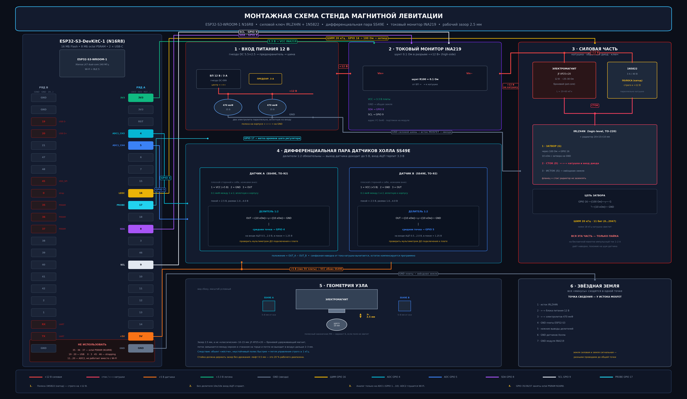
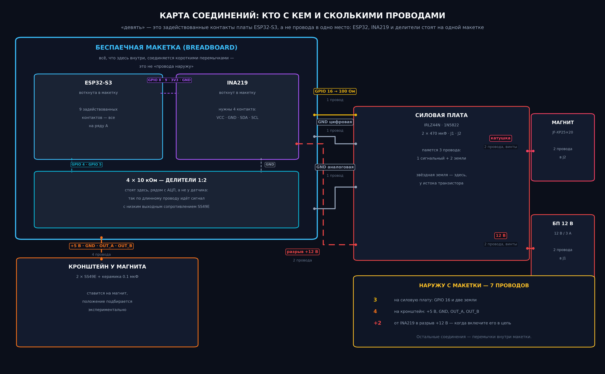
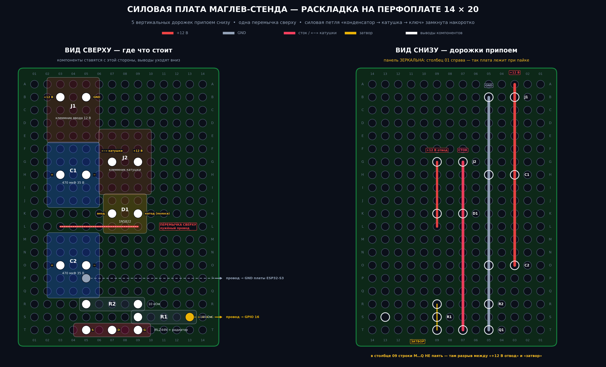

# 02 — System design

*[Русская версия](02-system-design.ru.md)*

---

## 1. Why each part is the part it is

| Choice | Alternative rejected | Reason |
|---|---|---|
| ESP32-S3, dual core | single-core MCU | the control loop is pinned to core 0 and Wi-Fi telemetry to core 1; on one core the network stack would steal ticks from an 11.3 ms unstable plant |
| IRLZ44N | IRF540 | **logic level.** IRF540 needs ~10 V of gate drive; from 3.3 V it never fully turns on, dissipates heavily in the linear region and eventually fails |
| 1N5822 Schottky | 1N4007 | the coil is an inductance; at turn-off the current must go somewhere or it appears as hundreds of volts across the drain. A slow rectifier does not clamp fast enough |
| Two 470 µF at the coil end | one capacitor at the input | the coil draws current in 20 kHz pulses; supply-lead inductance turns that into rail sag that reaches the analogue section as apparent sensor noise |
| Differential Hall pair | single Hall sensor | the coil field at the sensor is orders of magnitude larger than the ball's contribution; only the *difference* cancels it |
| 10k/10k dividers | direct connection | SS49E runs on 5 V and swings to its supply; the S3 ADC tolerates 3.3 V |
| PWM at 20 kHz | 5–10 kHz | below ~18 kHz the coil sings audibly. This is not cosmetic: it makes hours of tuning work intolerable |
| Hand-written int8 inference | TFLite Micro | 353 parameters do not justify a framework; the step time must be bounded and measurable, and the quantisation scheme is the object of study, so it must be visible |

## 2. Pin assignment on ESP32-S3

The classic ESP32 pinout does not carry over, and three separate constraints
force the assignment:

1. **GPIO 34/35 do not exist on the S3** as general ADC inputs.
2. **GPIO 35, 36, 37 are consumed by the octal PSRAM** of the N16R8 module.
   They are broken out on the header and are unusable.
3. **ADC2 stops working when Wi-Fi is enabled.** The project uses Wi-Fi
   telemetry, so analogue inputs must live on ADC1 — GPIO 1 to 10.

| Signal | Pin | Justification |
|---|---|---|
| Hall A | GPIO 4 | ADC1_CH3 |
| Hall B | GPIO 5 | ADC1_CH4 |
| PWM to gate | GPIO 16 | LEDC capable, not a strapping pin |
| I²C SDA / SCL | GPIO 8 / 9 | S3 defaults |
| Step-time probe | GPIO 17 | free; toggled at the start and end of the control step |

Forbidden: 35/36/37 (PSRAM), 19/20 (native USB), 0/3/45/46 (strapping),
43/44 (console UART), 11–20 for analogue (ADC2).

## 3. PWM resolution

LEDC resolution and frequency trade against each other:

$$\text{bits}_{max} = \log_2\!\left(\frac{80\ \text{MHz}}{f_{PWM}}\right)$$

At 20 kHz this permits 11 bits (2048 levels), which is what the firmware uses.
One duty LSB corresponds to 0.22 mA of coil current — about 0.09 % of the
0.25 A bias, far below the resolution of the position measurement, so PWM
quantisation is not a limiting factor.

## 4. Firmware architecture

| Core | Task | Period | Priority |
|---|---|---|---|
| 0 | ADC → filter → controller → PWM | 1 ms, hard | 20 |
| 1 | Wi-Fi AP, web UI, telemetry | best effort | default |

The control task uses `vTaskDelayUntil` for exact 1 kHz periodicity and
toggles GPIO 17 around the computation, which makes the step time directly
measurable on an oscilloscope rather than estimated.

**Safety interlock.** If the position estimate leaves the 0.8–6.0 mm window
for more than 50 consecutive ticks, the PWM is forced to zero and the
integrator is reset. Without this the coil sits at full current whenever the
ball is absent, which is both a thermal hazard and the fastest way to
misinterpret a dropped ball as a tuning problem.

**Derivative filtering.** A raw difference of a noisy position signal is
unusable, but every millisecond of filter delay eats phase margin on an
11.3 ms unstable pole. The firmware uses a first-order filter at τ = 2 ms,
the value the simulation identifies as the compromise point.

## 5. Grounding

All returns meet at a single point at the MOSFET source: supply negative,
capacitor negatives, MCU ground, divider bottoms, sensor grounds, INA219
ground. Power and signal returns run to that point as **separate wires**.

The failure mode this prevents is specific and common: a shared return turns
the coil's 20 kHz current pulses into a voltage that appears in the ADC's
reference, indistinguishable from sensor noise, and it is typically diagnosed
as a software problem for several days before anyone suspects the wiring.

The power stage is soldered on perfboard, never on breadboard: spring
contacts have tens of milliohms of unstable contact resistance, which at
1–2 A pulses produces exactly the same symptom.

