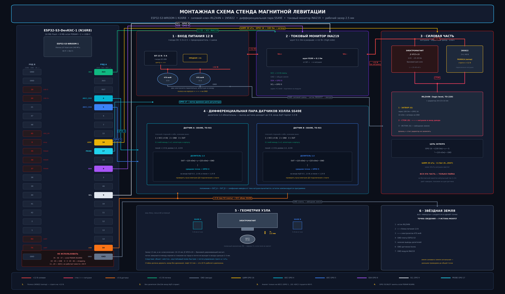
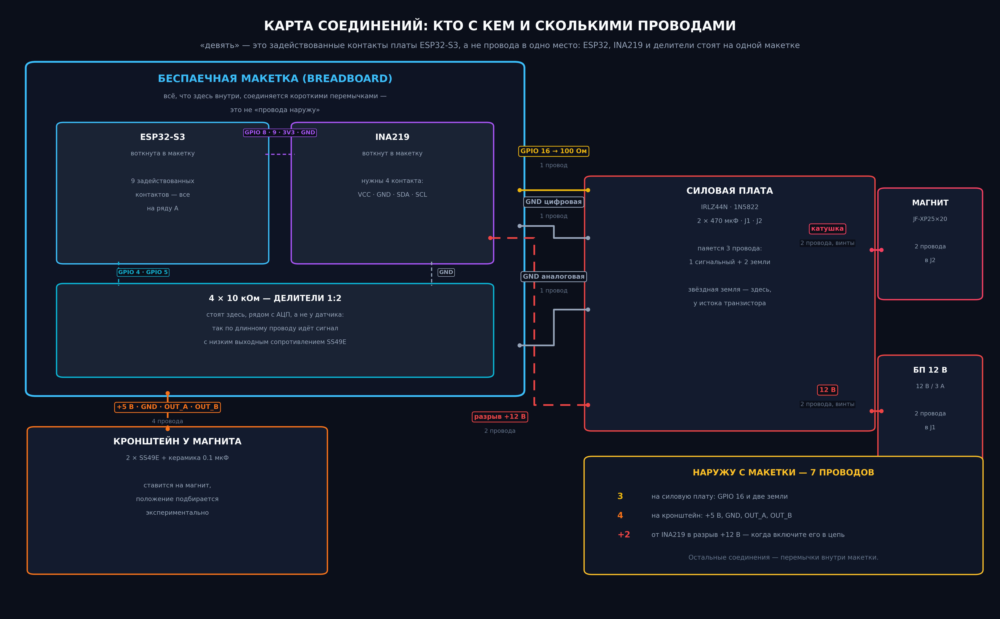
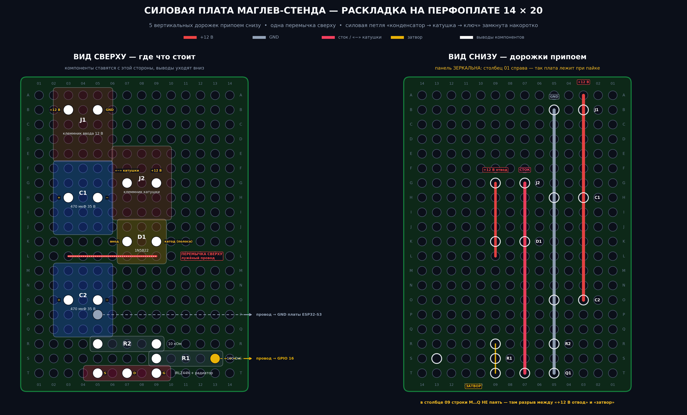

# 02 — Проект системы

*[English version](02-system-design.md)*

---

## 1. Почему каждая деталь именно такая

| Выбор | Отвергнутая альтернатива | Причина |
|---|---|---|
| ESP32-S3, два ядра | одноядерный МК | контур закреплён за ядром 0, а Wi-Fi-телеметрия за ядром 1; на одном ядре сетевой стек срывал бы такты у объекта с постоянной 11,3 мс |
| IRLZ44N | IRF540 | **logic level.** IRF540 требует ~10 В на затворе; от 3,3 В он не открывается полностью, греется в линейном режиме и в итоге выходит из строя |
| 1N5822, Шоттки | 1N4007 | катушка — индуктивность; при закрытии ключа току надо куда-то деться, иначе он проявится сотнями вольт на стоке. Медленный выпрямитель не успевает ограничить |
| Два 470 мкФ у катушки | один конденсатор на входе | катушка потребляет ток импульсами 20 кГц; индуктивность подводящих проводов превращает это в просадку шины, которая доходит до аналоговой части как кажущийся шум датчика |
| Дифференциальная пара Холла | один датчик | поле катушки в точке датчика на порядки больше вклада шарика; сокращает его только *разность* |
| Делители 10к/10к | прямое подключение | SS49E питается от 5 В и выдаёт размах до напряжения питания; АЦП S3 терпит 3,3 В |
| ШИМ 20 кГц | 5–10 кГц | ниже ~18 кГц катушка слышимо свистит. Это не косметика: часы настройки рядом с ней становятся невыносимыми |
| Инференс int8 вручную | TFLite Micro | 353 параметра не оправдывают фреймворк; время шага должно быть ограниченным и измеримым, а схема квантования — сам предмет исследования, она должна быть на виду |

## 2. Распиновка ESP32-S3

Распиновка классического ESP32 не переносится, и назначение выводов вынуждено
тремя независимыми ограничениями:

1. **GPIO 34/35 на S3 не существует** как аналоговых входов общего назначения.
2. **GPIO 35, 36, 37 заняты octal PSRAM** модуля N16R8. Они выведены на
   гребёнку и непригодны к использованию.
3. **ADC2 перестаёт работать при включённом Wi-Fi.** Проект использует
   Wi-Fi-телеметрию, поэтому аналоговые входы обязаны быть на ADC1 —
   GPIO с 1 по 10.

| Сигнал | Пин | Обоснование |
|---|---|---|
| Холл A | GPIO 4 | ADC1_CH3 |
| Холл B | GPIO 5 | ADC1_CH4 |
| ШИМ на затвор | GPIO 16 | поддерживает LEDC, не strapping-пин |
| I²C SDA / SCL | GPIO 8 / 9 | значения по умолчанию для S3 |
| Метка времени шага | GPIO 17 | свободен; переключается в начале и конце шага |

Запрещены: 35/36/37 (PSRAM), 19/20 (нативный USB), 0/3/45/46 (strapping),
43/44 (консольный UART), 11–20 для аналога (ADC2).

## 3. Разрешение ШИМ

Разрешение и частота LEDC связаны обратной зависимостью:

$$\text{бит}_{max} = \log_2\!\left(\frac{80\ \text{МГц}}{f_{ШИМ}}\right)$$

При 20 кГц это допускает 11 бит (2048 уровней), что и используется в прошивке.
Один младший разряд заполнения соответствует 0,22 мА тока катушки — около
0,09 % от тока смещения 0,25 А, много ниже разрешения измерения положения,
поэтому квантование ШИМ ограничивающим фактором не является.

## 4. Архитектура прошивки

| Ядро | Задача | Период | Приоритет |
|---|---|---|---|
| 0 | АЦП → фильтр → регулятор → ШИМ | 1 мс, жёстко | 20 |
| 1 | точка доступа Wi-Fi, веб-интерфейс, телеметрия | по готовности | по умолчанию |

Задача управления использует `vTaskDelayUntil` для точной периодичности 1 кГц
и переключает GPIO 17 вокруг вычисления, что делает время шага непосредственно
измеримым осциллографом, а не оцениваемым.

**Защитная блокировка.** Если оценка положения выходит за окно 0,8–6,0 мм
дольше чем на 50 тактов подряд, ШИМ принудительно обнуляется, а интегратор
сбрасывается. Без этого катушка остаётся под полным током всякий раз, когда
шарика нет, — это и тепловая опасность, и самый быстрый способ принять
упавший шарик за проблему настройки.

**Фильтрация производной.** Прямая разность зашумлённого сигнала положения
непригодна, но каждая миллисекунда задержки фильтра съедает запас по фазе
у неустойчивого полюса 11,3 мс. Прошивка использует фильтр первого порядка
с τ = 2 мс — значение, которое симуляция определяет как компромиссное.

## 5. Земля

Все возвраты сходятся в одной точке у истока MOSFET: минус питания, минусы
конденсаторов, земля МК, низы делителей, земли датчиков, земля INA219. Силовой
и сигнальный возвраты идут к этой точке **отдельными проводами**.

Отказ, который этим предотвращается, конкретен и распространён: общий возврат
превращает импульсы тока катушки частотой 20 кГц в напряжение, которое
появляется в опорной точке АЦП, неотличимо от шума датчика, — и обычно
несколько дней диагностируется как программная проблема, прежде чем кто-нибудь
заподозрит монтаж.

Силовая часть спаяна на перфоплате, а не собрана на макетной: пружинные
контакты имеют десятки миллиом нестабильного переходного сопротивления, что
при импульсах 1–2 А даёт ровно тот же симптом.

