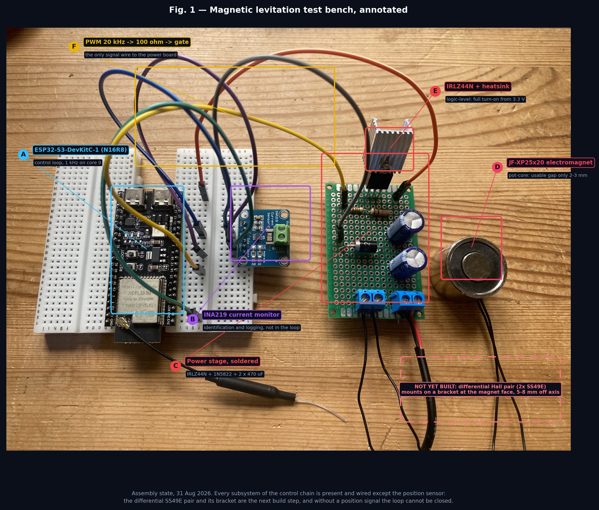

# 04 — Build log

*[Русская версия](04-build-log.ru.md)*

---

## 20 Aug 2026 — parts ordered

Electromagnet, Hall sensors, INA219, MOSFETs, diodes, passives, perfboard.
16 line items. The order was placed against a design that assumed a classic
ESP32 and a 10–15 mm working gap; both assumptions failed later and are
documented below.

## 29 Aug 2026 — actuator analysis

The magnet arrived and the first test was trivial: hold the ball near the face
and find where it is attracted. **1–2 mm, not the expected 10–15 mm.**

This produced [`01-actuator-analysis`](01-actuator-analysis.md) and moved the
operating point to 2.5 mm, which raised the unstable pole to 88.6 rad/s and
fixed the loop rate at 1 kHz. In retrospect this is the most useful thing that
has happened in the project so far, and it happened before any code existed.

## 31 Aug 2026 — the board is not the board in the drawing

The MCU that arrived is an **ESP32-S3-WROOM-1 N16R8**, not the classic ESP32
the schematic had been drawn for. Three separate problems surfaced at once:

- GPIO 34/35, used for the ADC inputs in the original drawing, do not exist;
- GPIO 35/36/37 are broken out on the header but consumed by the octal PSRAM;
- ADC2 is unusable with Wi-Fi enabled, which the original pinout ignored.

Everything was re-assigned to ADC1 (GPIO 4, 5) with PWM on GPIO 16 and I²C on
8/9. Had this been discovered after soldering rather than before, the power
board would have been scrap.

**Lesson recorded:** verify the actual silicon against the drawing before
soldering, not after. The module marking is on the shield can and takes ten
seconds to read.

## 31 Aug 2026 — power stage soldered

Built on double-sided perfboard, 14 × 20 holes.

Layout rationale: five vertical solder tracks on the underside, one jumper on
top, and the switching loop — capacitors → coil → MOSFET → capacitors — kept
as short as the board allows. Component lead pitches drove the layout more
than the schematic did:

| Part | Lead spacing | Effect on layout |
|---|---|---|
| Terminal blocks, electrolytics | 2 holes | sit directly across the rails |
| Resistors | 4 holes | span gate rail to ground rail |
| 1N5822 | 7 holes | forced its own row |
| IRLZ44N | 3 adjacent holes | source/drain/gate must land on adjacent tracks |

The last row is the constraint that shaped everything: the source and drain
tracks have to be adjacent, with the gate on a third track next to them, so
the rail order is fixed by the transistor rather than by preference.

**Pre-power checks** (all passed): no short between +12 V and ground; diode
conducts one way only, in the correct direction; 10 kΩ pulldown present on the
gate; heatsink isolated (it sits at drain potential).

## 31 Aug 2026 — system wired

ESP32-S3 and INA219 on breadboard; three wires to the power board (PWM plus
two separate grounds); coil and 12 V into the screw terminals.

Grounds are run separately to the star point rather than daisy-chained, which
costs two extra wires and removes the most common source of phantom sensor
noise.

## Current blocker — position sensor

The differential Hall pair is **not built**. It needs a rigid bracket holding
both SS49E 5–8 mm off the magnet axis, at the face, with 0.1 µF decoupling at
each sensor. Until it exists there is no position signal and the loop cannot
be closed.

This is the gating item for phases 3 and 4, and it carries the project's
largest technical risk — the pot-core geometry leaves very little external
field for the sensors to work with. Fallbacks are pre-committed in
[`05-limitations`](05-limitations.md#risk-1) rather than left to improvisation.

## Not yet purchased

| Item | Why it matters |
|---|---|
| **3 A fuse with holder** | the only short-circuit protection on the 12 V rail; omitted from the order |
| **Rigid stand** | must hold 2.5 mm without flexing — 0.5 mm of play is 20 % of the working range |
| Ø8 and Ø12 mm spheres | protocol P6, robustness |
| M4 steel bolt | pole extender, fallback B |

## Next steps

1. Run protocol P1 today — it needs only a multimeter and the 12 V supply.
2. Build the sensor bracket; run P3. This is the decision point for the whole
   project.
3. If P3 passes: identify the plant (P4), close the PID loop, then run P5.
4. If P3 fails: switch to the optical sensor without further tuning attempts.
