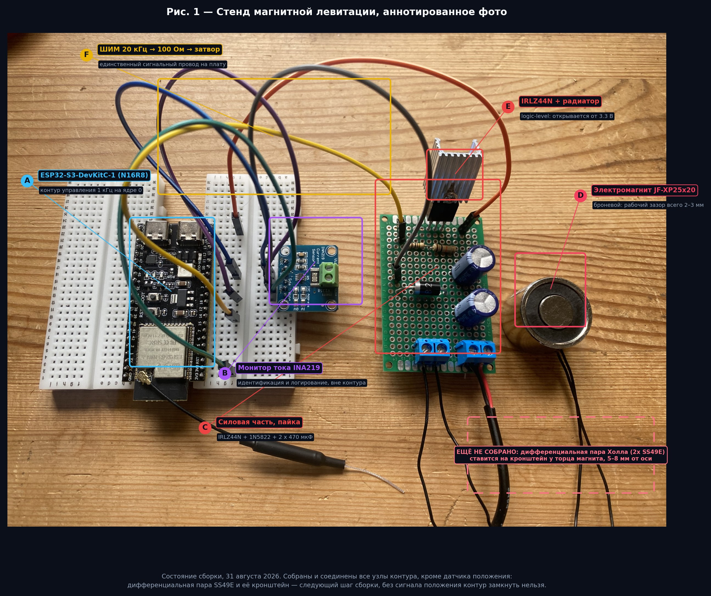

# 04 — Журнал сборки

*[English version](04-build-log.md)*

---

## 20 августа 2026 — заказ деталей

Электромагнит, датчики Холла, INA219, транзисторы, диоды, пассивные элементы,
перфоплаты. 16 позиций. Заказ размещался под проект, предполагавший классический
ESP32 и рабочий зазор 10–15 мм; оба предположения впоследствии не подтвердились
и задокументированы ниже.

## 29 августа 2026 — анализ актуатора

Магнит пришёл, и первая проверка была тривиальной: поднести шарик к торцу и
найти, откуда он притягивается. **1–2 мм, а не ожидаемые 10–15 мм.**

Из этого вырос документ [`01-actuator-analysis`](01-actuator-analysis.ru.md),
рабочая точка переехала на 2,5 мм, неустойчивый полюс поднялся до 88,6 рад/с,
а частота контура зафиксировалась на 1 кГц. Задним числом это самое полезное,
что случилось в проекте, и случилось оно до того, как появился хоть какой-то код.

## 31 августа 2026 — плата оказалась не той, что на чертеже

Пришедший микроконтроллер — **ESP32-S3-WROOM-1 N16R8**, а не классический
ESP32, под который рисовалась схема. Три проблемы вскрылись разом:

- GPIO 34/35, использованные под аналоговые входы в исходном чертеже,
  не существуют;
- GPIO 35/36/37 выведены на гребёнку, но заняты octal PSRAM;
- ADC2 непригоден при включённом Wi-Fi, чего исходная распиновка не учитывала.

Всё переназначено на ADC1 (GPIO 4, 5), ШИМ на GPIO 16, I²C на 8/9. Обнаружься
это после пайки, а не до неё, силовая плата отправилась бы в мусор.

**Записанный урок:** сверять реальный кристалл с чертежом до пайки, а не после.
Маркировка модуля нанесена на экран и читается за десять секунд.

## 31 августа 2026 — силовая часть спаяна

Собрана на двусторонней перфоплате 14 × 20 отверстий.

Логика раскладки: пять вертикальных дорожек припоем снизу, одна перемычка
сверху, а петля коммутации — конденсаторы → катушка → ключ → конденсаторы —
максимально короткая, насколько позволяет плата. Шаги выводов деталей повлияли
на раскладку сильнее, чем сама схема:

| Деталь | Шаг выводов | Влияние на раскладку |
|---|---|---|
| Клеммники, электролиты | 2 отверстия | садятся прямо на шины |
| Резисторы | 4 отверстия | перекрывают затворную шину до земляной |
| 1N5822 | 7 отверстий | потребовал отдельного ряда |
| IRLZ44N | 3 соседних отверстия | исток/сток/затвор обязаны попасть на соседние дорожки |

Последняя строка — то ограничение, которое определило всё остальное: дорожки
истока и стока обязаны быть соседними, а затвор — на третьей рядом, поэтому
порядок шин задан транзистором, а не предпочтением.

**Проверки до подачи питания** (все пройдены): нет замыкания между +12 В и
землёй; диод проводит только в одну сторону и в правильную; подтяжка 10 кОм на
затворе установлена; радиатор изолирован (на нём потенциал стока).

## 31 августа 2026 — система соединена

ESP32-S3 и INA219 на макетной плате; три провода на силовую плату (ШИМ и две
отдельные земли); катушка и 12 В в винтовые клеммники.

Земли ведутся к звёздной точке раздельно, а не цепочкой: это стоит двух лишних
проводов и снимает самый частый источник фантомного шума датчика.

## Текущий блокер — датчик положения

Дифференциальная пара Холла **не собрана**. Нужен жёсткий кронштейн,
удерживающий оба SS49E в 5–8 мм от оси магнита у торца, с керамикой 0,1 мкФ
у каждого датчика. Пока его нет, сигнала положения не существует и контур
замкнуть нельзя.

Это блокирующий элемент фаз 3 и 4, и он несёт наибольший технический риск
проекта — броневая геометрия оставляет снаружи очень мало поля, с которым
датчикам работать. Запасные варианты зафиксированы заранее в
[`05-limitations`](05-limitations.ru.md#риск-1), а не оставлены на импровизацию.

## Ещё не куплено

| Позиция | Почему важно |
|---|---|
| **Предохранитель 3 А с держателем** | единственная защита от КЗ на шине 12 В; в заказ не попал |
| **Жёсткая стойка** | должна держать 2,5 мм без прогиба — 0,5 мм люфта это 20 % рабочего диапазона |
| Шарики Ø8 и Ø12 мм | протокол P6, робастность |
| Стальной болт М4 | полюсный наконечник, запасной вариант Б |

## Следующие шаги

1. Выполнить протокол P1 сегодня — нужен только мультиметр и блок 12 В.
2. Собрать кронштейн датчиков, выполнить P3. Это точка принятия решения по
   всему проекту.
3. Если P3 пройден: идентифицировать объект (P4), замкнуть контур ПИД,
   затем выполнить P5.
4. Если P3 не пройден: переходить на оптический датчик, не пытаясь
   дальше настраивать.
